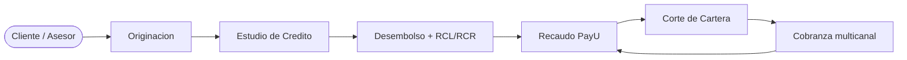
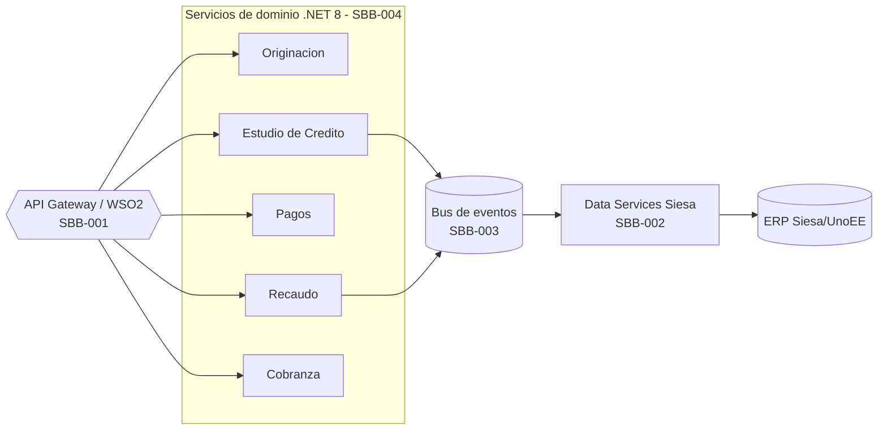
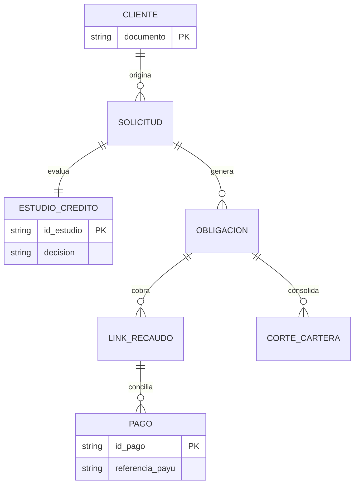
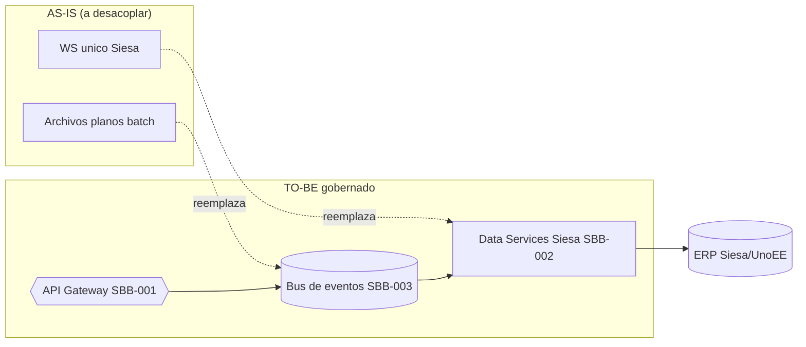
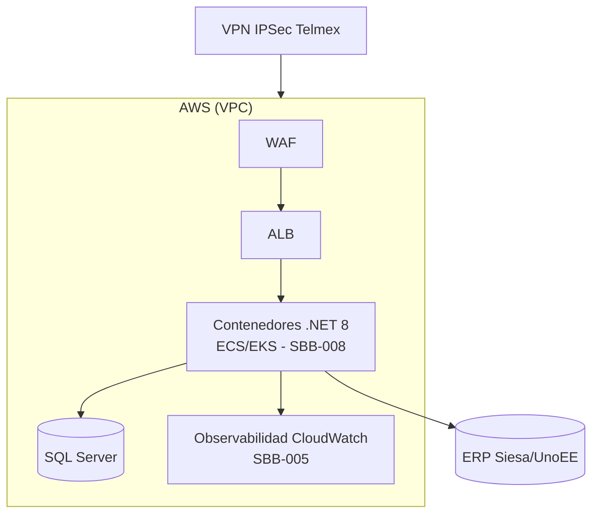
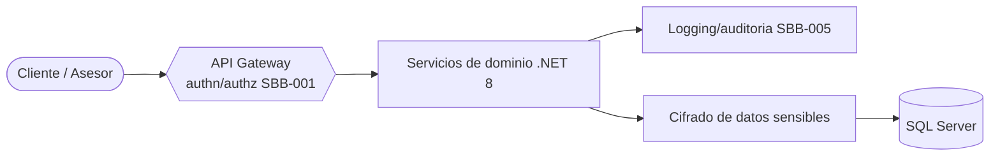

# 02 - Arquitectura TO-BE multinivel (Credi10 2.0)

> Capitulo de **arquitectura** del dossier TO-BE. Presenta vistas por nivel arquitectonico (negocio, aplicacion con C4 N1-3, datos con ERD por bounded context, integracion con desacople de Siesa, infraestructura AWS objetivo y seguridad). **Reutiliza y enlaza** la Fase 4 (`../../04-diseno-to-be.md`: C4, ADR-001..006, ERD, OpenAPI/AsyncAPI) sin contradecirla; aqui se consolidan las vistas por nivel.

> Etiquetas epistemicas: **[VERIFIED-FACT]** evidencia explicita del corpus; **[DOC-ASSUMPTION]** supuesto a validar; **[DOC-CONFLICT]** contradiccion entre fuentes; **[EPISTEMIC-VOID]** sin base documental (no se fabrica evidencia).

Niveles arquitectonicos cubiertos: **negocio**, **aplicacion**, **datos**, **integracion**, **infraestructura**, **seguridad**.

## Resumen por nivel arquitectonico

| Nivel arquitectonico | Vista TO-BE | Elementos clave | SBB / ADR |
| --- | --- | --- | --- |
| Negocio | Cadena de valor credito | Originacion -> Estudio -> Desembolso -> Recaudo -> Cartera -> Cobranza | - |
| Aplicacion (C4 N1-3) | Servicios de dominio tras API Gateway | WSO2 + .NET 8 por bounded context | SBB-001, SBB-004 |
| Datos | ERD por bounded context + fuente unica de verdad | Consolidar +200 BDs | SBB-007, ADR-005 |
| Integracion | APIs + eventos, desacople de Siesa | Data Services + bus de eventos | SBB-002, SBB-003, ADR-002 |
| Infraestructura | AWS objetivo | VPC/ALB/WAF, contenedores, VPN Telmex, SQL Server | SBB-008, ADR-006 |
| Seguridad | Zero-trust transversal | authn/authz, cifrado, trazabilidad STRIDE | SBB-001, SBB-005 |

## Nivel negocio

## Nivel aplicacion (C4 contenedores)

Vista de contenedores coherente con los diagramas C4 N1-3 de la Fase 4 (no se duplican; se enlazan en `../../04-diseno-to-be.md`):

## Nivel datos (ERD por bounded context)

## Nivel integracion (desacople de Siesa)

El cuello de botella AS-IS (WS unico + archivos planos, GAP-001) se reemplaza por Data Services gobernados (SBB-002) y un bus de eventos (SBB-003); nunca acceso directo a la BD del ERP (ADR-002):

## Nivel infraestructura (AWS objetivo)

## Nivel seguridad

> **Veredicto de cobertura:** seis niveles arquitectonicos con vista TO-BE, trazados a SBB-001..008 y ADR-001..006 de la Fase 4.

