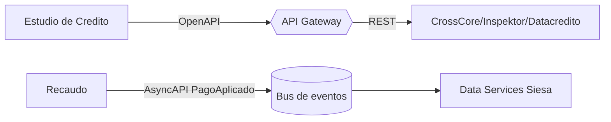

# 03 - Specs y contratos (TO-BE Credi10 2.0)

> Capitulo de **especificaciones** del dossier TO-BE: contratos API (OpenAPI/AsyncAPI esbozados), esquemas de datos, specs por modulo y specs de integracion. Las historias BDD/Gherkin completas (happy path + casos borde) por modulo viven en el **catalogo exhaustivo 04b** (`../../04b-catalogo-historias.md`) y se reutilizan aqui sin duplicarlas. Los contratos detallados estan en la Fase 4 (`../../04-diseno-to-be.md`).

> Etiquetas epistemicas: **[VERIFIED-FACT]** evidencia explicita del corpus; **[DOC-ASSUMPTION]** supuesto a validar; **[DOC-CONFLICT]** contradiccion entre fuentes; **[EPISTEMIC-VOID]** sin base documental (no se fabrica evidencia).

## Contrato API sincrono (OpenAPI esbozado)

```yaml
openapi: 3.0.3
info:
  title: Credi10 2.0 - Estudio de Credito
  version: 1.0.0
paths:
  /estudio-credito:
    post:
      summary: Inicia el estudio (CrossCore -> Inspektor -> Datacredito)
      responses:
        '200':
          description: Decision APROBADO/RECHAZADO/REVISION + score
        '424':
          description: Buro no disponible
```


## Contrato asincrono (AsyncAPI esbozado)

```yaml
asyncapi: 2.6.0
info:
  title: Credi10 2.0 - Evento PagoAplicado
  version: 1.0.0
channels:
  recaudo/pago-aplicado:
    subscribe:
      message:
        name: PagoAplicado
        payload:
          type: object
          properties:
            idPago: { type: string }
            referenciaPayU: { type: string }
```


## Esquema de datos (resumen)

| Entidad | Atributos clave | Bounded Context |
| --- | --- | --- |
| CLIENTE | documento (PK), nombre | Transversal |
| SOLICITUD | id_solicitud (PK), documento (FK), estado | Originacion |
| ESTUDIO_CREDITO | id_estudio (PK), decision, score | Estudio de Credito |
| OBLIGACION | id_obligacion (PK), saldo | Cartera |
| LINK_RECAUDO | id_link (PK), monto, estado | Recaudo |
| PAGO | id_pago (PK), referencia_payu | Recaudo |

## Specs por modulo (universo completo)

Cobertura: **17** modulos, **17** HU con Gherkin (ver 04b).

| Modulo | Spec de contrato (resumen) | Tipo | Integracion | HU |
| --- | --- | --- | --- | --- |
| MOD-01 Plataforma Credi10 / Administracion de creditos | Aplicacion central Credi10 (.NET), administracion de obligaciones y parametrizacion de productos de credito. | API/evento | Plataforma / Core | HU-01 |
| MOD-02 Originacion - CrossCore | Orquestacion de buros CrossCore dentro del estudio de credito (CrossCore -> Inspektor -> Datacredito). | API/evento | Estudio de Credito | HU-02 |
| MOD-03 Originacion - Inspektor | Consulta al servicio Inspektor como segundo eslabon del estudio de credito. | API/evento | Estudio de Credito | HU-03 |
| MOD-04 Originacion - Datacredito | Consulta al bureau Datacredito/Dictum como eslabon final del estudio de credito. | API/evento | Estudio de Credito | HU-04 |
| MOD-05 Originacion - Aplicacion ADMIN | Aplicacion ADMIN de originacion para gestion y revision de solicitudes. | API/evento | Originacion | HU-05 |
| MOD-06 Pagos / GenerarPagos | Generacion de pagos (FT-SL-003) y su registro. | API/evento | Pagos | HU-06 |
| MOD-07 Corte de Cartera | Proceso de corte de cartera (FT-SL-004) y consolidacion de saldos/mora. | API/evento | Corte / Cartera | HU-07 |
| MOD-08 Link de Recaudo / APIs de recaudo | Link de Recaudo (FT-SL-011) hacia PayU y conciliacion del pago. | API/evento | Recaudo | HU-08 |
| MOD-09 B2C / Portal de clientes | Portal B2C (Node.js + React + Wordpress), autoservicio del cliente. | API/evento | B2C / E-commerce | HU-09 |
| MOD-10 Boton E-commerce | Boton de pago e-commerce (integracion VTEX / comercio). | API/evento | B2C / E-commerce | HU-10 |
| MOD-11 Captura Foto | Captura fotografica de documentos y soportes en la originacion. | API/evento | Originacion | HU-11 |
| MOD-12 API Integrador Atencion al Cliente | API integrador de atencion al cliente (omnicanal Wolkvox / B2Chat). | API/evento | Atencion al Cliente | HU-12 |
| MOD-13 Llamada Predictiva | Marcacion predictiva de cobranza (WOLKVOX). | API/evento | Cobranza | HU-13 |
| MOD-14 Cobranza (SMS / WhatsApp / Email / Scheduler) | Scheduler de cobranza multicanal (SMS, WhatsApp, Email). | API/evento | Cobranza | HU-14 |
| MOD-15 Envio RCL y RCR | Generacion y envio de RCL/RCR (facturacion electronica en UnoEE, timbrado Numrot). | API/evento | Integracion ERP | HU-15 |
| MOD-16 Integracion UnoEE / Siesa | Integracion con el ERP Siesa/UnoEE (hoy archivos planos + WS unico; TO-BE Data Services + eventos). | API/evento | Integracion ERP | HU-16 |
| MOD-17 Fidelizacion / Pentaho (BI) | Fidelizacion y analitica/BI con Pentaho sobre datos de cartera. | API/evento | Cartera | HU-17 |

## Spec de integracion




> **Veredicto de cobertura:** contratos sincronos y asincronos esbozados, esquema de datos y specs para los 17 modulos, enlazados al catalogo 04b.

