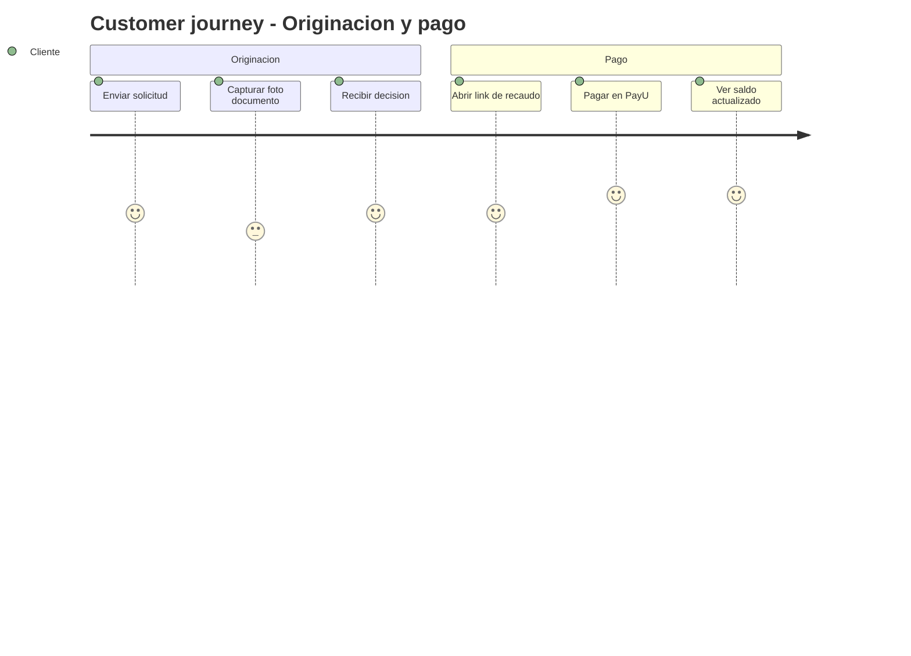
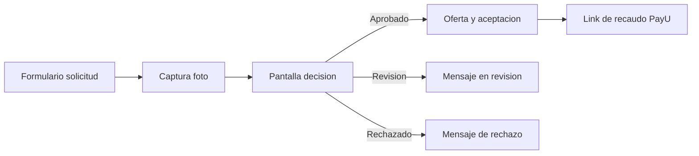

# 04 - UX y experiencia TO-BE (Credi10 2.0)

> Capitulo de **UX** del dossier TO-BE: service blueprints, customer journeys y wireflows/arquitectura de informacion para los flujos de **originacion, pagos, B2C y cobranza**. Las pantallas se describen de forma Mermaid/descriptiva (no hay mockups de alta fidelidad en el corpus [EPISTEMIC-VOID]).

> Etiquetas epistemicas: **[VERIFIED-FACT]** evidencia explicita del corpus; **[DOC-ASSUMPTION]** supuesto a validar; **[DOC-CONFLICT]** contradiccion entre fuentes; **[EPISTEMIC-VOID]** sin base documental (no se fabrica evidencia).

## Customer journey (originacion y pago)

## Wireflow / arquitectura de informacion

## Service Blueprint

| Capa del Service Blueprint | Originacion -> Recaudo |
| --- | --- |
| Evidencia fisica | Formulario web, confirmacion, link de pago |
| Acciones del cliente | Enviar solicitud, aceptar oferta, pagar en PayU |
| Frontstage (UX) | Pantalla solicitud, decision, pago (portal B2C) |
| Backstage | Orquestacion de buros, motor de reglas, RCL/RCR |
| Procesos de soporte | Data Services Siesa, bus de eventos, observabilidad |

## Journeys por flujo

| Journey | Canal | Modulos | Resultado esperado |
| --- | --- | --- | --- |
| Originacion | Asesor / web | MOD-05, MOD-11, MOD-02..04 | Solicitud decidida y trazable |
| Pagos / Recaudo | PayU / link | MOD-06, MOD-08 | Pago conciliado |
| B2C autoservicio | Portal B2C | MOD-09, MOD-10 | Cliente paga sin asesor |
| Cobranza | SMS/WhatsApp/Email/llamada | MOD-13, MOD-14 | Promesa de pago registrada |

> **Veredicto de cobertura:** blueprint + journey + wireflow para originacion, pagos, B2C y cobranza, trazados a los modulos MOD-xx.

