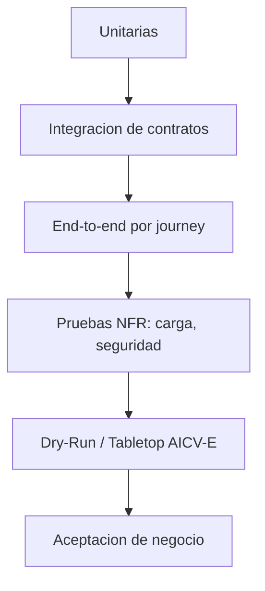

# 05 - Estrategia y plan de pruebas (TO-BE Credi10 2.0)

> Capitulo de **pruebas** del dossier TO-BE: estrategia por niveles, matriz de cobertura derivada de las HU/Gherkin (`../../04b-catalogo-historias.md`), plan de **Dry-Run / Tabletop** (gobierno AICV-E) y criterios de aceptacion. Cada HU aporta un caso happy y al menos un caso borde (Exception Storming).

> Etiquetas epistemicas: **[VERIFIED-FACT]** evidencia explicita del corpus; **[DOC-ASSUMPTION]** supuesto a validar; **[DOC-CONFLICT]** contradiccion entre fuentes; **[EPISTEMIC-VOID]** sin base documental (no se fabrica evidencia).

## Estrategia de pruebas por niveles

## Matriz de cobertura (HU -> casos)

Cobertura: **17** modulos, **17** HU, **34** escenarios (happy + borde).

| Modulo | HU | Caso happy | Caso borde (Exception Storming) | Nivel de prueba |
| --- | --- | --- | --- | --- |
| MOD-01 | HU-01 | Alta de un producto de credito (happy path) | Parametros invalidos (caso borde) | Unit + Integracion + E2E |
| MOD-02 | HU-02 | CrossCore responde correctamente (happy path) | CrossCore agota el timeout (caso borde, EX-01) | Unit + Integracion + E2E |
| MOD-03 | HU-03 | Inspektor entrega datos completos (happy path) | Inspektor devuelve datos incompletos (caso borde, EX-02) | Unit + Integracion + E2E |
| MOD-04 | HU-04 | Datacredito devuelve historial (happy path) | Cliente sin historial (no-hit) (caso borde, EX-03) | Unit + Integracion + E2E |
| MOD-05 | HU-05 | Resolucion manual de una solicitud (happy path) | Solicitud ya resuelta por otro analista (caso borde) | Unit + Integracion + E2E |
| MOD-06 | HU-06 | Generacion de pago (happy path) | Obligacion sin saldo (caso borde) | Unit + Integracion + E2E |
| MOD-07 | HU-07 | Corte periodico exitoso (happy path) | Corte interrumpido a mitad de proceso (caso borde) | Unit + Integracion + E2E |
| MOD-08 | HU-08 | Pago por link conciliado (happy path) | PayU no confirma el pago (caso borde, EX-04) | Unit + Integracion + E2E |
| MOD-09 | HU-09 | Autoconsulta y pago en el portal (happy path) | Portal sobre Wordpress/XAMPP degradado (caso borde) | Unit + Integracion + E2E |
| MOD-10 | HU-10 | Compra financiada con boton (happy path) | Transaccion rechazada por el medio de pago (caso borde) | Unit + Integracion + E2E |
| MOD-11 | HU-11 | Captura y validacion de foto (happy path) | Foto ilegible o de baja calidad (caso borde) | Unit + Integracion + E2E |
| MOD-12 | HU-12 | Consulta omnicanal unificada (happy path) | Fuente de datos no disponible (caso borde) | Unit + Integracion + E2E |
| MOD-13 | HU-13 | Campana predictiva conecta al deudor (happy path) | Sin agentes disponibles (caso borde) | Unit + Integracion + E2E |
| MOD-14 | HU-14 | Envio multicanal programado (happy path) | Canal caido en el envio (caso borde) | Unit + Integracion + E2E |
| MOD-15 | HU-15 | RCL/RCR timbrado y enviado (happy path) | Fallo de timbrado (caso borde) | Unit + Integracion + E2E |
| MOD-16 | HU-16 | Sincronizacion gobernada con Siesa (happy path) | Data Service de Siesa no disponible (caso borde, EX-04) | Unit + Integracion + E2E |
| MOD-17 | HU-17 | Tablero de fidelizacion actualizado (happy path) | Datos de origen incompletos (caso borde) | Unit + Integracion + E2E |

## Plan de Dry-Run / Tabletop

Cadena de validacion extremo a extremo (Evento -> UX -> Gherkin -> API -> C4 -> BD -> respuesta), ejecutada por el verificador (AM):

| Eslabon de la cadena de validacion | Artefacto |
| --- | --- |
| Evento | Cliente envia solicitud de credito |
| Pantalla UX | Formulario -> pantalla de decision |
| Regla Gherkin | Escenario happy path del estudio (HU-02..04) |
| Contrato API | POST /estudio-credito |
| Componente C4 | Servicio Estudio de Credito (.NET 8, SBB-004) |
| Tabla/Entidad BD | ESTUDIO_CREDITO (decision, score) |
| Respuesta al usuario | APROBADO/RECHAZADO/REVISION (umbral [DOC-ASSUMPTION]) |

## Criterios de aceptacion

| Criterio de aceptacion | Fuente | Estado objetivo |
| --- | --- | --- |
| Cada HU cubre happy path + caso borde | 04b / modules.py | Obligatorio |
| Reglas RN-01..RN-04 preservadas | RFP | Obligatorio |
| Nunca acceso directo a la BD de Siesa | ADR-002 | Obligatorio |
| Disponibilidad objetivo 99% en criticos | DRV-001 | Objetivo |

> **Veredicto de cobertura:** estrategia + matriz para 17 HU + plan de Dry-Run + criterios de aceptacion trazables al RFP y a los ADR.

