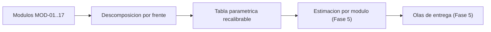

# 06 - Insumos de estimacion (TO-BE Credi10 2.0)

> Capitulo de **insumos de estimacion** del dossier TO-BE: descomposicion por modulo y frente de trabajo, una **tabla parametrica recalibrable**, los supuestos [DOC-ASSUMPTION] y las dependencias. **Consolida y enlaza** la estimacion detallada de la **Fase 5** (`../../05-roadmap-estimacion-raid.md`, T-Shirt + WSJF + person-months + olas) sin contradecirla. **Todas las cifras de esfuerzo son [DOC-ASSUMPTION]** (el corpus no trae cifras de esfuerzo reales).

> Etiquetas epistemicas: **[VERIFIED-FACT]** evidencia explicita del corpus; **[DOC-ASSUMPTION]** supuesto a validar; **[DOC-CONFLICT]** contradiccion entre fuentes; **[EPISTEMIC-VOID]** sin base documental (no se fabrica evidencia).

## Mapa de insumos de estimacion

## Descomposicion por modulo

Universo completo: **17** modulos (misma fuente unica que la Fase 5, `phases/modules.py`).

| Modulo | Bounded Context | Frentes de trabajo | Talla (T-Shirt) [DOC-ASSUMPTION] | Dependencias |
| --- | --- | --- | --- | --- |
| MOD-01 Plataforma Credi10 / Administracion de creditos | Plataforma / Core | Dev / Data / Integracion / QA / DevOps / Cambio | M [DOC-ASSUMPTION] | ABB-004, ABB-005 |
| MOD-02 Originacion - CrossCore | Estudio de Credito | Dev / Data / Integracion / QA / DevOps / Cambio | M [DOC-ASSUMPTION] | ABB-001, ABB-004 |
| MOD-03 Originacion - Inspektor | Estudio de Credito | Dev / Data / Integracion / QA / DevOps / Cambio | M [DOC-ASSUMPTION] | ABB-001, ABB-004 |
| MOD-04 Originacion - Datacredito | Estudio de Credito | Dev / Data / Integracion / QA / DevOps / Cambio | M [DOC-ASSUMPTION] | ABB-001, ABB-004 |
| MOD-05 Originacion - Aplicacion ADMIN | Originacion | Dev / Data / Integracion / QA / DevOps / Cambio | M [DOC-ASSUMPTION] | ABB-004, ABB-005 |
| MOD-06 Pagos / GenerarPagos | Pagos | Dev / Data / Integracion / QA / DevOps / Cambio | M [DOC-ASSUMPTION] | ABB-001, ABB-003 |
| MOD-07 Corte de Cartera | Corte / Cartera | Dev / Data / Integracion / QA / DevOps / Cambio | M [DOC-ASSUMPTION] | ABB-004, ABB-005 |
| MOD-08 Link de Recaudo / APIs de recaudo | Recaudo | Dev / Data / Integracion / QA / DevOps / Cambio | M [DOC-ASSUMPTION] | ABB-001, ABB-003 |
| MOD-09 B2C / Portal de clientes | B2C / E-commerce | Dev / Data / Integracion / QA / DevOps / Cambio | M [DOC-ASSUMPTION] | ABB-001, ABB-006 |
| MOD-10 Boton E-commerce | B2C / E-commerce | Dev / Data / Integracion / QA / DevOps / Cambio | M [DOC-ASSUMPTION] | ABB-001, ABB-003 |
| MOD-11 Captura Foto | Originacion | Dev / Data / Integracion / QA / DevOps / Cambio | M [DOC-ASSUMPTION] | ABB-004 |
| MOD-12 API Integrador Atencion al Cliente | Atencion al Cliente | Dev / Data / Integracion / QA / DevOps / Cambio | M [DOC-ASSUMPTION] | ABB-001, ABB-004 |
| MOD-13 Llamada Predictiva | Cobranza | Dev / Data / Integracion / QA / DevOps / Cambio | M [DOC-ASSUMPTION] | ABB-001, ABB-004 |
| MOD-14 Cobranza (SMS / WhatsApp / Email / Scheduler) | Cobranza | Dev / Data / Integracion / QA / DevOps / Cambio | M [DOC-ASSUMPTION] | ABB-003, ABB-004 |
| MOD-15 Envio RCL y RCR | Integracion ERP | Dev / Data / Integracion / QA / DevOps / Cambio | M [DOC-ASSUMPTION] | ABB-002, ABB-003 |
| MOD-16 Integracion UnoEE / Siesa | Integracion ERP | Dev / Data / Integracion / QA / DevOps / Cambio | M [DOC-ASSUMPTION] | ABB-002, ABB-003 |
| MOD-17 Fidelizacion / Pentaho (BI) | Cartera | Dev / Data / Integracion / QA / DevOps / Cambio | M [DOC-ASSUMPTION] | ABB-004, ABB-005 |

## Tabla parametrica recalibrable

Todas las cifras son [DOC-ASSUMPTION] y se recalibran con historicos del equipo; no son compromisos:

| Parametro recalibrable | Valor base [DOC-ASSUMPTION] | Nota |
| --- | --- | --- |
| Factor por talla S / M / L / XL | 0.5 / 1 / 2 / 4 | Multiplicador relativo, recalibrable |
| Esfuerzo base por modulo (person-months) | 1.0 pm | Ancla de la tabla; ajustar con historicos |
| Factor de integracion Siesa | +0.5 pm | Sobrecosto por desacople del WS/archivos planos |
| Factor de migracion .NET 8 | +0.3 pm | Por obsolescencia .NET 4.8 / Core 3.1 |
| Contingencia por vacio epistemico | +15% | Por PDFs solo-imagen [EPISTEMIC-VOID] |

## Supuestos de estimacion

| ID | Supuesto de estimacion | Etiqueta |
| --- | --- | --- |
| SUP-01 | Todas las cifras de esfuerzo son indicativas y recalibrables | [DOC-ASSUMPTION] |
| SUP-02 | El contrato real del WS de Siesa no esta en el corpus; su esfuerzo se estima con contingencia | [EPISTEMIC-VOID] |
| SUP-03 | Los umbrales de scoring se confirmaran con negocio (PRE-003) | [DOC-ASSUMPTION] |
| SUP-04 | La consolidacion de +200 BDs requiere inventario previo (PRE-002) | [DOC-ASSUMPTION] |

> **Veredicto de cobertura:** descomposicion de los 17 modulos + tabla parametrica recalibrable + supuestos, todo enlazado a la Fase 5; cifras [DOC-ASSUMPTION].

