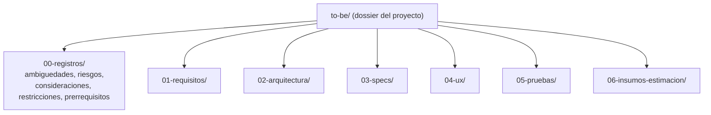

# Dossier de proyecto TO-BE - Credi10 2.0

> **Dossier TO-BE** generado de forma **determinista** por el motor del advisory (`advisory-system/phases/dossier.py`), organizado con **una subcarpeta por etapa/practica del SDLC** mas **registros transversales** del proyecto en todos los niveles arquitectonicos. No es un documento escrito a mano: se regenera con el quickstart. Fundamentado en la Base de Conocimiento (**18** documentos del corpus, sin muestreo).

> **Regenerar el dossier (parte de `--phase all`):**
>
> ```bash
> python3 advisory-system/quickstart.py --phase all
> ```

El dossier reutiliza las unicas fuentes de verdad del motor (`phases/modules.py` MOD-01..MOD-17, `phase4.py` SBB-001..008, `phase3.py` GAP/REL/ABB y los indicadores del RFP), de modo que no duplica contenido sino que lo consolida por etapa del SDLC.

> Etiquetas epistemicas: **[VERIFIED-FACT]** evidencia explicita del corpus; **[DOC-ASSUMPTION]** supuesto a validar; **[DOC-CONFLICT]** contradiccion entre fuentes; **[EPISTEMIC-VOID]** sin base documental (no se fabrica evidencia).

## Estructura por etapa del SDLC




| Etapa SDLC | Carpeta | Contenido |
| --- | --- | --- |
| Registros transversales | `00-registros/` | ambiguedades, riesgos, consideraciones, restricciones, prerrequisitos (todos los niveles) |
| Requisitos | `01-requisitos/` | RF por modulo + NFR ISO 25010 + reglas de negocio + trazabilidad |
| Arquitectura | `02-arquitectura/` | vistas TO-BE por nivel (negocio/aplicacion/datos/integracion/infra/seguridad) |
| Specs | `03-specs/` | contratos API/eventos, esquemas de datos, specs por modulo |
| UX | `04-ux/` | blueprints, journeys, wireflows |
| Pruebas | `05-pruebas/` | estrategia, matriz, Dry-Run, aceptacion |
| Insumos de estimacion | `06-insumos-estimacion/` | descomposicion + tabla parametrica + supuestos |

## Registros transversales (todos los niveles arquitectonicos)

Niveles arquitectonicos cubiertos: **negocio**, **aplicacion**, **datos**, **integracion**, **infraestructura**, **seguridad**.

| Registro | Archivo | Entradas | Niveles cubiertos |
| --- | --- | --- | --- |
| Ambiguedades | `00-registros/ambiguedades.md` | 5 | 5 de 6 |
| Riesgos | `00-registros/riesgos.md` | 9 | 6 de 6 |
| Consideraciones | `00-registros/consideraciones.md` | 6 | 6 de 6 |
| Restricciones | `00-registros/restricciones.md` | 6 | 6 de 6 |
| Prerrequisitos | `00-registros/prerrequisitos.md` | 6 | 6 de 6 |

## Capitulos del dossier

- [`01-requisitos/requisitos.md`](01-requisitos/requisitos.md)
- [`02-arquitectura/arquitectura.md`](02-arquitectura/arquitectura.md)
- [`03-specs/specs.md`](03-specs/specs.md)
- [`04-ux/ux.md`](04-ux/ux.md)
- [`05-pruebas/pruebas.md`](05-pruebas/pruebas.md)
- [`06-insumos-estimacion/insumos-estimacion.md`](06-insumos-estimacion/insumos-estimacion.md)

## Relacion con los informes por fase

El dossier NO reemplaza los informes por fase (`../00..06-*.md` y `../04b-catalogo-historias.md`): los consolida en una vista orientada a **ejecutar el proyecto** por etapa del SDLC y enlaza a ellos para el detalle (C4/ADR/ERD, Gherkin, estimacion).

> **Veredicto QG-dossier:** GO - dossier con 6 etapas del SDLC + registros transversales (32 entradas) en los 6 niveles arquitectonicos, generado deterministamente.

