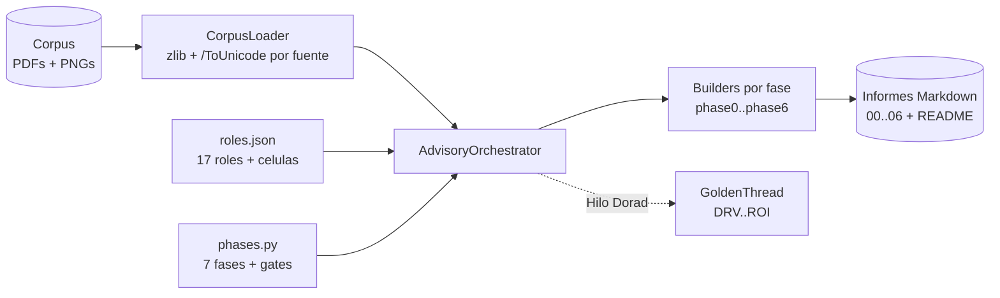

# advisory-system - Motor Zero-Drift para el Advisory Credi10 2.0

`advisory-system/` es un **motor de orquestacion escrito en Python puro (solo
biblioteca estandar)** que ejecuta el advisory de Credi10 2.0 con el framework
**Zero-Drift** y genera un informe en Markdown por cada una de las 7 fases (mas
un indice), con diagramas Mermaid, tablas y veredictos Go/No-Go.

Los informes generados viven en [`../advisory-credi10-2.0/`](../advisory-credi10-2.0/)
y son 100% reproducibles re-ejecutando el quickstart. Ademas de los 7 informes
por fase, `--phase all` ahora **tambien regenera la Base de Conocimiento**
(`../knowledge-base/`), un **catalogo exhaustivo de Historias de Usuario +
BDD/Gherkin** (`04b-catalogo-historias.md`) y un **dossier de proyecto TO-BE**
organizado por etapa del SDLC (`../advisory-credi10-2.0/to-be/`).

> **Alcance: solo advisory.** Todo lo que produce este motor es
> **documentacion** para la siguiente etapa (informes Markdown, catalogo de HU,
> Base de Conocimiento). **No** se genera codigo de la solucion/producto. El
> unico codigo Python es el **motor generador de informes** (`advisory-system/`)
> y sus pruebas; los `SKILL.md` de `.kiro/skills/` son **documentacion de
> politica declarativa**, no codigo de aplicacion.

## Estrategia

El framework **Zero-Drift** se modela como **datos declarativos + plantillas por
fase + un orquestador**, de modo que el *que* (contenido del advisory) queda
separado del *como* (motor de ejecucion):

- **Roles declarativos.** Los 17 roles (ED, EM, AM, EA, BA, PIA, SME, TDA, DRE,
  SA, DA, PM, UX, AIA, FIN, SEC, ORG), el Comite de Gobierno y las 3 Celulas se
  definen como datos en `roles/roles.json` y se cargan en dataclasses `Role`.
- **Fases declarativas.** Las 7 fases (0..6), su liderazgo **RACI-V**, sus
  entregables, su **quality gate** (QG-0..QG-6) y el archivo de informe que
  producen se declaran en `engine/phases.py`.
- **Plantillas por fase.** Cada fase tiene un *builder* (`phases/phaseN.py`) que
  recibe un `BuildContext` y devuelve el cuerpo Markdown del informe. El
  contenido esta fundamentado en el corpus real (RFP, assessment WSO2/Studio F,
  diagramas).
- **Orquestador.** `engine/orchestrator.py` ejecuta cada fase en secuencia
  RACI-V: engancha a los productores (R), corre la verificacion del gate (V,
  gobierno AICV-E del AM), invoca al builder y escribe el informe.
- **Hilo Dorado.** `engine/model.py` mantiene un `GoldenThread` que encadena IDs
  unicos a traves de las fases
  (DRV -> CAP -> BMK -> GAP -> REL -> ABB -> SBB -> WAV -> ROI), de modo que cada
  decision tecnica es trazable hasta un indicador de retorno del RFP.

Principios transversales del framework: **RACI-V** (separacion productor R /
verificador V), **AICV-E** (gobierno de calidad a cargo del AM), **Hilo Dorado**
de trazabilidad, validacion **Dry-Run / Tabletop** antes del build y
**stage-gates** con No-Go explicito.

## Capa de politicas declarativas (`.kiro/skills/`)

Las decisiones de *como* se procesa el corpus se externalizan como **skills
declarativos versionados** (`.kiro/skills/<nombre>/SKILL.md` con frontmatter
`name`/`description`/`version`). Son **politicas de la organizacion**, agnosticas
del cliente, pensadas para reutilizarse en otros contextos/corpus:

- **`complete-corpus-ingestion`** - politica de ingesta y validacion **COMPLETA**
  del corpus: procesamiento y entendimiento garantizados, nada de muestreo
  parcial.
- **`token-budget-optimization`** - estrategias/tecnicas para optimizar el
  consumo de tokens **garantizando** el procesamiento y entendimiento completos
  (resumen jerarquico, deduplicacion, chunking estable).
- **`zero-drift-roles-policy`** - politica permanente de **tomar y validar la
  informacion y el contexto de TODA la documentacion** antes de concluir, con un
  **checklist** que alimenta la Base de Conocimiento.
- **`ai-opportunities-catalog`** - oportunidades de IA modeladas como skill
  declarativo (dos tracks: IA-como-producto e IA-como-acelerador-de-
  construccion), **no hardcodeadas** en el codigo.
- **`sdlc-project-dossier`** - politica de producir el entregable TO-BE como un
  **dossier con una subcarpeta por etapa del SDLC** mas registros transversales
  (ambiguedades/riesgos/consideraciones/restricciones/prerrequisitos) en todos
  los niveles arquitectonicos, generado de forma determinista.
- **`commercial-proposal-report`** - politica del **informe 1** (propuesta
  comercial): documento de venta con las 11 secciones a-k, perfil corporativo e
  inversion marcados [DOC-ASSUMPTION].
- **`executive-management-report`** - politica del **informe 2** (reporte
  gerencial): soporte ejecutivo de la propuesta (alcance, fases, diagnostico,
  estrategia, riesgos, consideraciones, prerrequisitos) en tono gerencial.
- **`technical-narrative-multilevel`** - politica del **informe 3** (informe
  tecnico): estructura **multinivel** (fase -> tema -> subtema), con narrativa
  de analisis sustancial (no solo tablas/Mermaid) orientada a una estimacion lo
  mas acertada posible.
- **`ocr-image-extraction`** - politica declarativa de **OCR**: cuando aplicarlo
  (PDF/PNG con bajo ratio de texto util / paginas solo-imagen), los motores
  soportados en orden de preferencia (pytesseract/Tesseract, ocrmypdf,
  pdfimages+tesseract, pdftoppm+tesseract), el umbral de confianza, la etiqueta
  epistemica `[OCR-EXTRACTED]` para el texto recuperado y la **regla de
  degradacion honesta** cuando no hay motor disponible (no se inventa texto; se
  registra 'OCR pendiente / no disponible' y se reporta la cobertura real).
- **`requirements-traceability`** - politica del **Anexo A** de trazabilidad de
  requisitos: responder **punto a punto** cada solicitud del cliente con **cita
  al documento fuente**; como se derivan las solicitudes **dinamicamente** del
  corpus; los dos artefactos obligatorios (checklist marcable + tabla de
  trazabilidad) y la regla de degradacion (Pendiente + `[EPISTEMIC-VOID]` donde
  falta texto util / OCR).
- **`document-extraction-architecture`** - politica de la **arquitectura de
  extraccion multicapa** (Anexo B): la estrategia y tactica para **maximizar el
  texto util** de cada documento con una escalera de capas y fallbacks (L1 texto
  nativo + decodificacion de fuentes `/ToUnicode` **[implementado]**, L2 OCR de
  paginas imagen, L3 vision/LLM multimodal, L4 NLP/LLM de post-proceso), con
  umbrales de confianza, validacion de cobertura, gobernanza epistemica, una
  tabla tactica por tipo de documento y un diagrama Mermaid del flujo de
  decision. Integra `complete-corpus-ingestion`, `ocr-image-extraction` y
  `token-budget-optimization`, y marca que capa esta implementada aqui (L1) vs
  cual requiere el entorno de produccion (L2-L4).

El motor las carga con `engine/skills.py` (`SkillsLoader`): descubre los
`SKILL.md`, parsea el frontmatter y convierte el catalogo de IA en entradas
estructuradas que la Fase 4 renderiza. Si la carpeta `.kiro/skills/` no existe,
la carga **degrada con elegancia** (devuelve listas vacias) y el pipeline sigue
siendo ejecutable y determinista.

## Base de Conocimiento generada (`knowledge-base/`)

`engine/knowledge.py` construye de forma **determinista** una
`KnowledgeBase` a partir de los documentos ingeridos y el orquestador la escribe
en `../knowledge-base/` durante `--phase all`:

- **`README.md`** - indice por documento: sha256, tipo (pdf/png), rol
  primario/secundario, tamanio y banda de cobertura.
- **`coverage-checklist.md`** - checklist de cobertura que confirma
  `N/N documentos procesados` (sin muestreo) y marca honestamente los documentos
  de baja cobertura / **[EPISTEMIC-VOID]** (p. ej. PDFs escaneados sin capa de
  texto util o PNGs binarios), sin fabricar evidencia. La banda se **recalibra
  por texto util REAL** (ver abajo), no por tamanio crudo.
- **`key-facts.md`** - hechos clave consolidados, cada uno **trazable** a su
  documento fuente.
- **`documents/<id>.md`** - resumen jerarquico por documento.

La Base de Conocimiento es la fuente que el advisory consume para trazar cada
decision a su evidencia; la Fase 5 ata la **incertidumbre de estimacion** de
cada modulo a la banda de cobertura de su documento fuente.

### Cobertura por texto util REAL (no por tamanio crudo)

La banda de cobertura y el flag epistemico de cada documento ya **no** se
derivan del tamanio del texto extraido (`texto_limpio / bytes`), que
**sobrestimaba** la cobertura de los PDF basados en imagen. Ahora se derivan del
**texto util real**:

```
useful_ratio = caracteres en palabras reales (>= 3 letras, con acentos)
               / bytes de texto extraido
```

Las perillas declarativas viven en `engine/knowledge.py`: `USEFUL_TEXT_BANDS`
(alta >= 40%, media >= 20%, baja >= 3%, si no `nula`) y
`MIN_USEFUL_RATIO_FOR_TEXT` (3%, umbral por debajo del cual un PDF se considera
basado en imagen -> `[EPISTEMIC-VOID]` + 'OCR pendiente'). Las funciones
`count_useful_chars`, `useful_text_ratio` y `useful_text_band` son deterministas
y estan cubiertas por pruebas.

### Mejora del extractor: decodificacion `/ToUnicode` por fuente (recuperacion de texto NATIVO, no OCR)

En una primera medicion con el extractor ingenuo (regex de parentesis sobre
**cada** stream descomprimido), los 15 PDF del corpus Credi10 caian a bandas
'baja' o 'nula' y **ninguno** llegaba a 'alta'; cinco de ellos (WSO2 Assessment,
B2C, ProcesoCorteCartera, Originacion API Inspektor, Api Integrador) quedaban en
`nula` + `[EPISTEMIC-VOID]`. La **causa raiz** NO era que fueran paginas-imagen:
el texto si existe en la capa de texto del PDF, pero (1) usa **fuentes embebidas
Type0/Identity-H con codificacion personalizada** cuyos codigos solo se mapean a
Unicode via el CMap `/ToUnicode` de cada fuente, y (2) el extractor viejo tambien
**filtraba bytes binarios de imagen/fuente como si fueran texto**, inflando el
denominador y hundiendo el ratio de texto util.

La solucion (`engine/pdf_text.py`, **solo stdlib** `zlib` + `re`, **determinista**)
lee unicamente dentro de las regiones de texto `BT...ET`, rastrea la fuente
activa via el operador `Tf`, y decodifica tanto literales `( ... )` (con escapes
octales) como cadenas hex `< ... >` en `Tj`/`TJ`/`'`/`"` mapeando cada codigo por
el `/ToUnicode` (y `/Encoding /Differences` como respaldo) de la fuente activa,
con separacion de palabras por kerning en los arreglos `TJ`. Es **tolerante a
fallos**: una fuente sin `/ToUnicode` degrada a la heuristica latin-1 y nunca
aborta el documento. Esto es **recuperacion de texto NATIVO** (capa L1), **no
OCR**: el texto recuperado es parte de la capa de texto del PDF, por lo que
permanece `[VERIFIED-FACT]` (no `[OCR-EXTRACTED]`).

### Comparativa de texto util ANTES / DESPUES

Con la decodificacion por fuente, **los 15 PDF pasaron a banda 'alta'** y los **5
documentos antes en `nula` / `[EPISTEMIC-VOID]` se recuperaron a texto nativo
`[VERIFIED-FACT]`**. Ganancias netas de los 5 criticos (texto util, en puntos
porcentuales):

| Documento | Antes | Despues |
| --- | ---: | ---: |
| WSO2 y Studio F - Assessment | 1.60% nula | 69.74% alta |
| B2C | 2.55% nula | 54.60% alta |
| ProcesoCorteCartera | 1.09% nula | 53.85% alta |
| Originacion API Inspektor | 0.99% nula | 68.27% alta |
| Api Integrador Atencion al cliente | 0.70% nula | 64.31% alta |

Los 10 PDF restantes (que ya extraian algo pero en banda 'baja') tambien
subieron a 'alta' (p. ej. Llamada predictiva 7.15% -> 75.66%, RFP 5.92% ->
73.05%). Los 3 PNG, transcripcion humana estatica, se mantienen sin cambios
('alta'). El resumen de bandas pasa de dispersion en baja/nula a **18/18
'alta'**. La comparativa completa, con delta por documento y prosa honesta sobre
que subio y por que, se emite en `knowledge-base/coverage-checklist.md` (tabla
antes/despues leida de la linea base declarativa `USEFUL_TEXT_BASELINE_PCT` vs el
`useful_ratio` vivo). El limite honesto: una pagina que sea imagen raster real
(JPEG `DCTDecode`) sin capa de texto seguiria necesitando OCR real (capa L2), que
no esta disponible en este entorno.

### Capa complementaria: reconstruccion lexica (`engine/lexical.py`)

Sobre el texto ya recuperado por la decodificacion de fuentes se aplica una
**capa complementaria de reconstruccion lexica** (`engine/lexical.py`, **solo
stdlib**, **determinista** e **idempotente**). **No es OCR y no fabrica texto**:
solo **re-une lo que el espaciado del PDF partio** y **elimina maquetacion sin
contenido**, subiendo el ratio de texto util sin corromper el texto legitimo.
Se integra como ultimo paso de `clean_text` en `engine/corpus.py`, separada de
la decodificacion de fuentes.

Dos transformaciones **conservadoras** (tasa de falsos positivos ~0):

1. **Colapso de guias de puntos de TOC** (`collapse_dot_leaders`): las corridas
   de `. . . . .` que conectan un titulo con su numero de pagina son artefactos
   de maquetacion sin contenido lexico; en algunos documentos (p. ej. el
   Assessment WSO2 y el Api Integrador) representaban ~5-7% de los caracteres y
   hundian el denominador. Colapsarlas es analogo al colapso de espacios.
2. **Re-union de mayuscula partida** (`rejoin_split_capitals`): re-pega una
   **unica consonante mayuscula suelta** a la palabra en minuscula que le sigue
   (`id C liente` -> `id Cliente`), con **guardas** que impiden fusionar nombres
   propios (`Studio F podra` conserva su `F`, porque el token previo esta en
   mayuscula) y palabras distintas. Al operar solo sobre **consonantes**, nunca
   consume las palabras espanolas de una letra (`a`/`y`/`o`/`e`/`u`, todas
   vocales).

**Principio: ante la duda, NO se une.** Los cortes ambiguos (letras minusculas
sueltas con direccion de union indeterminable sin diccionario, pares de silabas
cortas) se dejan **intactos** a proposito: es preferible un fragmento suelto a
una fusion incorrecta (el clasico bug `fragmentad`). La capa preserva URLs,
codigos (`FT-DG-002`), puntuacion y separadores reales, y conserva el flag
`[VERIFIED-FACT]` (texto NATIVO reconstruido, no inventado).

**Ganancia adicional** (sobre la linea base de solo-decodificacion de fuentes,
`USEFUL_TEXT_FONT_DECODED_PCT`): **12 de 18 documentos suben y ninguno baja**.
Destacan el Assessment WSO2 (69.74% -> 74.90%, **+5.16 pp**) y el Api Integrador
(64.31% -> 69.65%, **+5.34 pp**); el resto de PDF suben entre +0.1 y +1.4 pp y
los 3 PNG + los PDF ya limpios se mantienen. La comparativa completa, con el
trayecto de tres etapas (**linea base original -> tras decodificacion de fuentes
-> tras reconstruccion lexica**) y prosa honesta, se emite en
`knowledge-base/coverage-checklist.md` (seccion *Ganancia adicional: capa de
reconstruccion lexica*).

### Arquitectura IA/OCR multicapa de extraccion (L1-L4)

La decodificacion de fuentes es la **capa L1** de una estrategia de extraccion
**multicapa** disenada para maximizar el texto util de todo tipo de documento:
L1 texto nativo + decodificacion `/ToUnicode` **[implementado aqui]**, L2 OCR de
paginas-imagen (`[OCR-EXTRACTED]`), L3 vision/LLM multimodal para layout/tablas/
diagramas complejos, y L4 NLP/LLM de post-proceso para estructuracion y
extraccion de entidades con trazabilidad. Esa estrategia y sus tacticas (
umbrales de confianza, validacion de cobertura, gobernanza epistemica, tabla
tactica por tipo de documento y diagrama de flujo con fallback) se documentan en
el skill generico `document-extraction-architecture` y se presentan como
recomendacion de advisory en el **Anexo B** generado del informe tecnico (ver mas
abajo). **Solo L1 esta implementado en este sandbox**; L2-L4 requieren el entorno
de produccion (motores OCR, modelos de vision y LLM que aqui no estan
disponibles).

### Capacidad OCR con degradacion honesta (`engine/ocr.py`)

El modulo `engine/ocr.py` (solo stdlib) es la contraparte de motor del skill
`ocr-image-extraction`. Hace un **sondeo de capacidad en tiempo de ejecucion**
(`detect_ocr_capability()`): detecta binarios via `shutil.which` (tesseract,
ocrmypdf, pdfimages, pdftoppm) y modulos via `try/except ImportError`
(pytesseract, PIL, fitz, ...), **sin romper** si faltan.

- **Si hay motor disponible:** `extract_text_via_ocr(path)` ejecuta el OCR y
  devuelve `(texto, '[OCR-EXTRACTED]')`; el documento se re-mide por texto util
  y `enrich_document` lo etiqueta `[OCR-EXTRACTED]` con el metodo de ingesta OCR.
- **Si NO hay motor (este entorno):** degrada de forma **honesta**: devuelve
  `('', '[EPISTEMIC-VOID]')`, **nunca fabrica texto**, mantiene el texto nativo
  sin cambios (salida byte-identica) y registra el metodo 'OCR pendiente (motor
  no disponible en este entorno)'. La capacidad OCR queda **lista y probada**
  (incluida la ruta 'con motor' via un stub/fake en las pruebas), aunque no se
  ejecute un binario real aqui.

La capacidad se sondea **una sola vez por corrida** (en `enrich_corpus`) y se
reutiliza en todos los documentos, de modo que el pipeline sigue siendo
determinista.

### Anexo A - Trazabilidad de requisitos (dinamico y reutilizable)

`phases/requirements_traceability.py` genera, durante `--phase all`, el **Anexo
A** del informe tecnico bajo
`advisory-credi10-2.0/3-informe-tecnico/anexo-a-trazabilidad-requisitos/`. El
anexo responde **punto a punto** cada solicitud del cliente presente en el
corpus y contiene **dos** artefactos:

1. un **checklist marcable** de que desarrollar (`- [x]` Cubierto / `- [~]`
   Parcial / `- [ ]` Pendiente), y
2. una **tabla de trazabilidad** con columnas exactas `ID | Solicitud del
   cliente | Cita al documento fuente | Donde se responde (fase/seccion/
   entregable) | Estado | Evidencia/Nota`.

Es **dinamico** (no hardcodeado para Credi10): `extract_requirements()` prioriza
el documento tipo RFP por heuristica de rol/nombre y complementa con el resto;
localiza **anclas de seccion** portadoras de requisitos (objetivos, alcance,
requisitos, informes, evaluacion, indicadores de retorno) con una normalizacion
sin espacios/acentos robusta a la fragmentacion del PDF, y como respaldo generico
detecta numerales/vinetas. Cada solicitud recibe un **ID estable** `REQ-NNN`, una
**cita** a su documento (y seccion cuando es recuperable) y un **Estado** honesto
derivado de las senales de texto util / OCR de la Base de Conocimiento
(**Pendiente + [EPISTEMIC-VOID]** cuando el documento fuente no tiene texto
util). Con el corpus de **otro cliente** el anexo se **regenera** con sus
solicitudes. El generador es llamable directamente con una `KnowledgeBase` o una
lista de `Document`, lo que lo hace comprobable sobre un corpus sintetico.

### Anexo B - Arquitectura IA multicapa de extraccion (fundamentado en el corpus)

`phases/extraction_architecture.py` genera, durante `--phase all`, el **Anexo B**
del informe tecnico bajo
`advisory-credi10-2.0/3-informe-tecnico/anexo-b-arquitectura-extraccion/`.
Presenta, como recomendacion de advisory, la **arquitectura de extraccion
documental multicapa (L1-L4)** cuyo objetivo es **maximizar el texto util** de
todo el corpus: L1 texto nativo + decodificacion de fuentes (`/ToUnicode`), L2
OCR de paginas imagen, L3 vision/LLM multimodal y L4 NLP/LLM de post-proceso.
Incluye narrativa sustancial en espanol, un **diagrama Mermaid** del flujo de
decision con fallback y la **tabla tactica por tipo de documento**.

Esta **fundamentado en el analisis de cobertura real**: las cifras de texto util
**antes/despues** se leen de la Base de Conocimiento viva (`doc.useful_ratio`) y
de la linea base declarativa `engine.knowledge.USEFUL_TEXT_BASELINE_PCT`, de modo
que **no se hardcodean** y se mantienen en sincronia con el analisis. El anexo
separa de forma **explicita** lo **implementado aqui (L1**, decodificacion de
fuentes en `engine/pdf_text.py`) de lo que requiere el **entorno de produccion
(L2-L4**, OCR/vision/NLP), y nombra los limites honestos (paginas `DCTDecode` que
siguen necesitando OCR real). Gobernado por el skill
`document-extraction-architecture`.

## Universo de modulos como fuente unica de verdad (`phases/modules.py`)

El listado de modulos de Credi10 (MOD-01..MOD-17, con sus HU y escenarios
Gherkin happy + borde) se declara **una sola vez** en `phases/modules.py`. Lo
reutilizan: el catalogo `phases/catalog.py` (que renderiza
`04b-catalogo-historias.md`, con `len(MODULES)` modulos, sin muestreo), el
builder de la Fase 4 y la **estimacion por modulo** de la Fase 5. Asi la
cobertura es COMPLETA y **testeable** (`len(MODULES)` == modulos cubiertos).

La **Fase 5** profundiza la planificacion: estimacion por modulo (T-Shirt + WSJF
+ story points / person-months) derivada de una **tabla parametrica
recalibrable**, descomposicion por frente, roadmap por olas (gantt) con ruta
critica y dependencias aciclicas, una **evaluacion del dueno de negocio** sobre
la suficiencia para crear el proyecto y un **analisis de riesgo de desfase de
tiempos** (schedule-slip) con veredicto Go/No-Go. Todas las cifras de esfuerzo
son **[DOC-ASSUMPTION]** (esfuerzo relativo, recalibrable).

## Dossier de proyecto TO-BE por etapa del SDLC (`../advisory-credi10-2.0/to-be/`)

`phases/dossier.py` genera, de forma **determinista** y durante `--phase all`,
un **dossier de proyecto TO-BE** pensado para **ejecutar el proyecto**: una
subcarpeta por etapa/practica del SDLC mas registros transversales en todos los
niveles arquitectonicos. No se escribe a mano; se regenera con el quickstart y
reutiliza las fuentes unicas de verdad del motor (`phases/modules.py`,
`phases/phase4.py` SBBs, `phases/phase3.py` gaps/relievers/ABBs) y la Base de
Conocimiento, sin duplicarlas.

Estructura (bajo `../advisory-credi10-2.0/to-be/`):

- **`00-registros/`** - registros **transversales** del proyecto, uno por
  archivo: `ambiguedades.md` (AMB-), `riesgos.md` (RSK-),
  `consideraciones.md` (CON-), `restricciones.md` (RST-) y
  `prerrequisitos.md` (PRE-). Cada entrada lleva **ID**, **nivel
  arquitectonico** (`negocio`, `aplicacion`, `datos`, `integracion`,
  `infraestructura`, `seguridad`), **severidad/impacto**, **estado** y una
  **etiqueta epistemica** donde aplique. Incluyen, entre otros, la tension de
  alcance +150 apps / +200 BDs de Studio F vs. ~20 componentes de Credi10
  [DOC-CONFLICT], el riesgo de lectura directa a la BD del ERP Siesa, la
  obsolescencia de .NET Framework 4.8 / .NET Core 3.1, la dependencia de la VPN
  IPSec con Telmex y el licenciamiento de SQL Server Enterprise.
- **`01-requisitos/`** - requisitos funcionales por modulo + NFR ISO/IEC 25010
  + reglas de negocio + trazabilidad al Hilo Dorado.
- **`02-arquitectura/`** - vistas TO-BE por nivel (negocio, aplicacion C4 N1-3,
  datos con ERD, integracion con desacople de Siesa, infraestructura AWS,
  seguridad); reutiliza/enlaza la Fase 4.
- **`03-specs/`** - contratos OpenAPI/AsyncAPI esbozados, esquemas de datos y
  specs por modulo; enlaza el catalogo 04b de HU/Gherkin.
- **`04-ux/`** - service blueprints, customer journeys y wireflows de
  originacion, pagos, B2C y cobranza.
- **`05-pruebas/`** - estrategia por niveles, matriz de cobertura HU->casos,
  plan de Dry-Run/Tabletop y criterios de aceptacion.
- **`06-insumos-estimacion/`** - descomposicion por modulo, tabla parametrica
  recalibrable y supuestos; consolida/enlaza la estimacion de la Fase 5 (todas
  las cifras de esfuerzo son **[DOC-ASSUMPTION]**).
- **`README.md`** - indice del dossier con el mapa de la estructura y el comando
  de regeneracion.

Cada capitulo cumple el contrato estructural (>= 1 diagrama Mermaid, >= 1 tabla
y etiquetas epistemicas). La politica declarativa que respalda este entregable
es el skill `sdlc-project-dossier` en `.kiro/skills/` (generica y agnostica del
cliente). La regeneracion es **determinista**: una segunda corrida de
`--phase all` deja `git status --short` vacio.

## Los tres informes del engagement (familia de 3)

Ademas de los informes por fase y del dossier, `--phase all` genera **tres
informes separados** en `../advisory-credi10-2.0/`, cada uno con su proposito,
audiencia y skill-politica:

1. **Propuesta comercial** (`1-propuesta-comercial.md`, skill
   `commercial-proposal-report`): documento de **venta** emitido por Kulgops con
   las 11 secciones a-k (quienes somos, alcance, contexto de negocio,
   metodologia, entregables, estrategia, equipo, cronograma, supuestos y
   restricciones, inversion y terminos). Perfil de Kulgops e inversion marcados
   [DOC-ASSUMPTION].
2. **Reporte gerencial** (`2-reporte-gerencial.md`, skill
   `executive-management-report`): soporte **ejecutivo** de la propuesta
   (alcance, fases, diagnostico de alto nivel, estrategia, riesgos,
   consideraciones y prerrequisitos) en tono gerencial, no tecnico.
3. **Informe tecnico** (`3-informe-tecnico/`, skill
   `technical-narrative-multilevel`): el **detalle** que sustenta a los otros
   dos y habilita la estimacion.

### Estructura multinivel del informe tecnico (`3-informe-tecnico/`)

`phases/technical_report.py` genera, de forma **determinista**, el informe
tecnico como una **vista multinivel narrativa**:

- **Nivel 1 = fase.** Una subcarpeta por cada una de las 7 fases Zero-Drift
  (`fase-0-higiene-epistemica/` ... `fase-6-caso-de-negocio/`), cada una con un
  `README.md` indice y su hilo narrativo.
- **Nivel 2 = tema.** Varios archivos de tema por fase (p. ej. en la Fase 4:
  `arquitectura-c4.md`, `adrs.md`, `modelo-datos-y-contratos.md`,
  `catalogo-ia.md`, `ux-y-pruebas.md`).
- **Nivel 3 = subtema.** Jerarquia interna H1 -> H2 -> H3 en cada archivo.

La **regla de calidad clave** (lo que el usuario mas pide) es que cada archivo
lleva **narrativa/analisis sustancial en prosa** ademas de tablas y Mermaid:
interpreta los hallazgos y explica sus implicaciones para la **estimacion**, la
**estrategia de implementacion** y los **riesgos**. El informe reutiliza (no
duplica) los builders por fase y **re-itera todas las fases** enriqueciendolas.

El informe tecnico **integra el dossier TO-BE** por referencia inequivoca como
su **vista de ejecucion** (el `README.md` maestro enlaza `../to-be/README.md`).
Los informes planos por fase (`00..06` + `04b`) se **conservan** como la vista
compacta canonica de cada fase (gobernada por los gates QG-0..QG-6); el informe
tecnico es la vista navegable que los reorganiza y enriquece. El `README.md`
maestro de `../advisory-credi10-2.0/` enlaza los tres informes.

## Reutilizar las politicas con otro corpus/cliente

Las skills y la Base de Conocimiento son **a nivel de organizacion**, no
especificas de Credi10. Para aplicar el mismo advisory a otro cliente:

1. Coloca el nuevo corpus en una carpeta y apunta el motor con
   `--corpus /ruta/al/nuevo/corpus` (y, si quieres, `--out /ruta/salida`).
2. Las politicas en `.kiro/skills/` se aplican **tal cual** (ingesta completa,
   optimizacion de tokens con entendimiento garantizado, toma/validacion de todo
   el contexto, catalogo de IA): no requieren edicion por cliente.
3. El motor genera, para ese corpus, su propia Base de Conocimiento + checklist
   de cobertura y los informes. El `phases/modules.py` (universo de modulos) y el
   contenido fundamentado en el corpus son lo unico especifico del cliente y se
   ajustan para el nuevo encargo.

## Restriccion stdlib-only y extraccion de PDF

El entorno **no tiene acceso a PyPI** (no se puede `pip install`), por lo que el
motor usa **exclusivamente la biblioteca estandar de Python 3.11**.

Para leer el corpus **no** se usan librerias de PDF (pymupdf/pdfplumber no estan
disponibles). La extraccion de texto se hace con un enfoque **`zlib` +
decodificacion `/ToUnicode` por fuente** (modulo `engine/pdf_text.py`): se
localizan los streams `FlateDecode` del PDF, se **descomprimen con `zlib`** y se
leen solo las regiones de texto `BT...ET`, decodificando literales `( ... )` y
cadenas hex `< ... >` de los operadores `Tj`/`TJ`/`'`/`"` a traves del CMap
`/ToUnicode` (y `/Encoding /Differences`) de la fuente activa rastreada por `Tf`;
luego se limpia la fragmentacion de caracteres y las etiquetas de idioma y se
aplica la **capa complementaria de reconstruccion lexica** (`engine/lexical.py`:
colapso de guias de puntos de TOC + re-union conservadora de mayuscula partida,
ver 'Capa complementaria' mas arriba). Esta es
**recuperacion de texto NATIVO (capa L1), no OCR**, por lo que el texto
recuperado permanece `[VERIFIED-FACT]`. Gracias a esta decodificacion por fuente,
**los 15 PDF del corpus Credi10 pasaron a banda 'alta'** (ver 'Mejora del
extractor' y 'Comparativa ANTES / DESPUES' mas arriba), incluidos los 5 que antes
caian a `nula` + `[EPISTEMIC-VOID]`.

Los **diagramas PNG** son imagenes binarias: se registran como evidencia
(sha256, tamanio) y su contenido se transcribe estaticamente en el conocimiento
de los roles/corpus. Para los casos que la capa nativa **no** resuelve (una
pagina que sea imagen raster real `DCTDecode` sin capa de texto), el motor
reclasifica honestamente por texto util (no por tamanio crudo) y expone una
capacidad **OCR** lista (`engine/ocr.py`, capa L2) que se ejecuta **si** hay motor
disponible y degrada de forma honesta cuando no lo hay (ver 'Capacidad OCR' mas
arriba): en este entorno no hay motor OCR, de modo que cualquier remanente queda
'OCR pendiente' / `[EPISTEMIC-VOID]` sin fabricar texto. Con el corpus actual la
capa L1 recupera texto util suficiente en los 18 documentos, por lo que el OCR no
llega a consultarse.

## Estructura del directorio

```
advisory-system/
├── quickstart.py          # CLI de entrada (--phase, --corpus, --out)
├── README.md              # este documento
├── engine/                # nucleo del motor
│   ├── corpus.py          # CorpusLoader: descubre PDFs/PNGs y extrae texto (delega en pdf_text)
│   ├── pdf_text.py        # extractor PDF por fuente: /ToUnicode CMap + Tf + Tj/TJ (texto nativo L1, no OCR)
│   ├── lexical.py         # reconstruccion lexica conservadora (colapso TOC + re-union mayuscula partida; no OCR)
│   ├── knowledge.py       # KnowledgeBase determinista (indice + resumenes + hechos + checklist; banda por texto util real)
│   ├── ocr.py             # adaptador OCR (sondeo de capacidad + extraccion con degradacion honesta)
│   ├── skills.py          # SkillsLoader: carga .kiro/skills y parsea el catalogo de IA
│   ├── model.py           # Role, Phase, Gate, RACI-V, GoldenThread (Hilo Dorado)
│   ├── phases.py          # catalogo declarativo de fases + gates + builders + catalogo 04b
│   ├── gating.py          # evaluate_gate: contrato estructural + trazabilidad del Hilo Dorado
│   └── orchestrator.py    # AdvisoryOrchestrator: ejecuta fases, escribe informes + knowledge-base
├── roles/                 # catalogo declarativo de los 17 roles
│   ├── __init__.py        # carga roles.json en dataclasses Role
│   └── roles.json         # datos de roles, comite y celulas
├── phases/                # builders de contenido por fase
│   ├── builders.py        # BUILDERS (0..6) + build_readme (indice)
│   ├── modules.py         # UNICA fuente de verdad del universo de modulos (MOD-01..MOD-17)
│   ├── catalog.py         # render de 04b-catalogo-historias.md (HU/Gherkin exhaustivo)
│   ├── dossier.py         # dossier TO-BE por etapa del SDLC + registros transversales
│   ├── commercial_proposal.py  # informe 1: propuesta comercial (Kulgops)
│   ├── executive_report.py     # informe 2: reporte gerencial ejecutivo
│   ├── technical_report.py     # informe 3: informe tecnico multinivel narrativo
│   ├── requirements_traceability.py  # Anexo A: trazabilidad de requisitos dinamica (checklist + tabla)
│   ├── extraction_architecture.py    # Anexo B: arquitectura IA multicapa de extraccion (L1-L4), fundamentada en el corpus
│   └── phase0.py .. phase6.py  # contenido fundamentado en el corpus por fase
└── tests/                 # pruebas unittest (stdlib)
    └── test_engine.py

../.kiro/skills/           # politicas declarativas reutilizables (SKILL.md) - documentacion
../knowledge-base/         # Base de Conocimiento GENERADA (indice + resumenes + hechos + checklist)
```

## Como ejecutar

Desde la **raiz del repositorio** (`advisory/`):

```bash
# Pipeline completo: 7 informes (00..06) + catalogo 04b + README indice
# + Base de Conocimiento (knowledge-base/) + checklist de cobertura
python3 advisory-system/quickstart.py --phase all

# Regenerar una sola fase (ej. Fase 3)
python3 advisory-system/quickstart.py --phase 3

# Apuntar a otro corpus u otra carpeta de salida
python3 advisory-system/quickstart.py --corpus /ruta/al/corpus --out /ruta/salida
```

El corpus se **auto-descubre** en la raiz del repo (el padre de
`advisory-system/`) cuando no se pasa `--corpus`. Los informes se escriben en
`advisory-credi10-2.0/` por defecto.

## Como correr las pruebas

```bash
python3 -m unittest discover -s advisory-system/tests -v
```

Las pruebas validan el `CorpusLoader` (descubrimiento y extraccion del RFP), los
17 roles, las 7 fases y el contrato estructural de cada informe (Mermaid, tablas,
etiquetas epistemicas y veredicto de gate), ademas de contenido real por fase.
Tambien cubren las capas nuevas: ingesta COMPLETA de los 18 documentos + Base de
Conocimiento determinista + checklist de cobertura; carga de los skills
declarativos y parseo del catalogo de IA (con degradacion elegante si falta la
carpeta); cobertura COMPLETA del universo de modulos por HU/Gherkin
(`len(MODULES)` sin muestreo); estimacion por modulo + tabla parametrica +
roadmap/ruta critica + evaluacion del dueno de negocio + riesgo de desfase; y un
chequeo de que **todos** los quality gates (QG-0..QG-6 y el QG-4b del catalogo)
evaluan GO con el corpus real.

> Nota: la suite ejecuta el quickstart como subproceso en algunas pruebas y
> puede tardar varios minutos; conviene correrla con un timeout amplio.

## Como se regeneran los informes

Los archivos de `advisory-credi10-2.0/*.md`, el **dossier TO-BE**
`advisory-credi10-2.0/to-be/` **y** la Base de Conocimiento
`../knowledge-base/` son **artefactos generados**: se versionan para que el
resultado del advisory sea visible, pero siempre pueden reproducirse con
`python3 advisory-system/quickstart.py --phase all`. La regeneracion es
**determinista**: ejecutar `--phase all` dos veces deja `git status --short`
vacio (sin aleatoriedad ni timestamps). Para cambiar el contenido de un informe
se edita su builder (`phases/phaseN.py`, `phases/catalog.py` o `build_readme` en
`phases/builders.py`); el universo de modulos se edita en `phases/modules.py`.
El motor (`engine/`) no necesita modificarse para cambiar contenido.

## Arquitectura del motor


