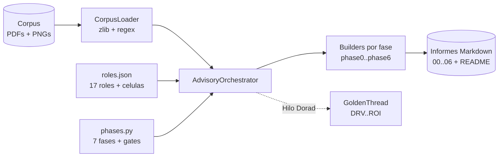

# advisory-system - Motor Zero-Drift para el Advisory Credi10 2.0

`advisory-system/` es un **motor de orquestacion escrito en Python puro (solo
biblioteca estandar)** que ejecuta el advisory de Credi10 2.0 con el framework
**Zero-Drift** y genera un informe en Markdown por cada una de las 7 fases (mas
un indice), con diagramas Mermaid, tablas y veredictos Go/No-Go.

Los informes generados viven en [`../advisory-credi10-2.0/`](../advisory-credi10-2.0/)
y son 100% reproducibles re-ejecutando el quickstart. Ademas de los 7 informes
por fase, `--phase all` ahora **tambien regenera la Base de Conocimiento**
(`../knowledge-base/`) y un **catalogo exhaustivo de Historias de Usuario +
BDD/Gherkin** (`04b-catalogo-historias.md`).

> **Alcance: solo advisory.** Todo lo que produce este motor es
> **documentacion** para la siguiente etapa (informes Markdown, catalogo de HU,
> Base de Conocimiento). **No** se genera codigo de la solucion/producto. El
> unico codigo Python es el **motor generador de informes** (`advisory-system/`)
> y sus pruebas; los `SKILL.md` de `.kiro/skills/` son **documentacion de
> politica declarativa**, no codigo de aplicacion.

## Estrategia

El framework **Zero-Drift** se modela como **datos declarativos + plantillas por
fase + un orquestador**, de modo que el *que* (contenido del advisory) queda
separado del *como* (motor de ejecucion):

- **Roles declarativos.** Los 17 roles (ED, EM, AM, EA, BA, PIA, SME, TDA, DRE,
  SA, DA, PM, UX, AIA, FIN, SEC, ORG), el Comite de Gobierno y las 3 Celulas se
  definen como datos en `roles/roles.json` y se cargan en dataclasses `Role`.
- **Fases declarativas.** Las 7 fases (0..6), su liderazgo **RACI-V**, sus
  entregables, su **quality gate** (QG-0..QG-6) y el archivo de informe que
  producen se declaran en `engine/phases.py`.
- **Plantillas por fase.** Cada fase tiene un *builder* (`phases/phaseN.py`) que
  recibe un `BuildContext` y devuelve el cuerpo Markdown del informe. El
  contenido esta fundamentado en el corpus real (RFP, assessment WSO2/Studio F,
  diagramas).
- **Orquestador.** `engine/orchestrator.py` ejecuta cada fase en secuencia
  RACI-V: engancha a los productores (R), corre la verificacion del gate (V,
  gobierno AICV-E del AM), invoca al builder y escribe el informe.
- **Hilo Dorado.** `engine/model.py` mantiene un `GoldenThread` que encadena IDs
  unicos a traves de las fases
  (DRV -> CAP -> BMK -> GAP -> REL -> ABB -> SBB -> WAV -> ROI), de modo que cada
  decision tecnica es trazable hasta un indicador de retorno del RFP.

Principios transversales del framework: **RACI-V** (separacion productor R /
verificador V), **AICV-E** (gobierno de calidad a cargo del AM), **Hilo Dorado**
de trazabilidad, validacion **Dry-Run / Tabletop** antes del build y
**stage-gates** con No-Go explicito.

## Capa de politicas declarativas (`.kiro/skills/`)

Las decisiones de *como* se procesa el corpus se externalizan como **skills
declarativos versionados** (`.kiro/skills/<nombre>/SKILL.md` con frontmatter
`name`/`description`/`version`). Son **politicas de la organizacion**, agnosticas
del cliente, pensadas para reutilizarse en otros contextos/corpus:

- **`complete-corpus-ingestion`** - politica de ingesta y validacion **COMPLETA**
  del corpus: procesamiento y entendimiento garantizados, nada de muestreo
  parcial.
- **`token-budget-optimization`** - estrategias/tecnicas para optimizar el
  consumo de tokens **garantizando** el procesamiento y entendimiento completos
  (resumen jerarquico, deduplicacion, chunking estable).
- **`zero-drift-roles-policy`** - politica permanente de **tomar y validar la
  informacion y el contexto de TODA la documentacion** antes de concluir, con un
  **checklist** que alimenta la Base de Conocimiento.
- **`ai-opportunities-catalog`** - oportunidades de IA modeladas como skill
  declarativo (dos tracks: IA-como-producto e IA-como-acelerador-de-
  construccion), **no hardcodeadas** en el codigo.

El motor las carga con `engine/skills.py` (`SkillsLoader`): descubre los
`SKILL.md`, parsea el frontmatter y convierte el catalogo de IA en entradas
estructuradas que la Fase 4 renderiza. Si la carpeta `.kiro/skills/` no existe,
la carga **degrada con elegancia** (devuelve listas vacias) y el pipeline sigue
siendo ejecutable y determinista.

## Base de Conocimiento generada (`knowledge-base/`)

`engine/knowledge.py` construye de forma **determinista** una
`KnowledgeBase` a partir de los documentos ingeridos y el orquestador la escribe
en `../knowledge-base/` durante `--phase all`:

- **`README.md`** - indice por documento: sha256, tipo (pdf/png), rol
  primario/secundario, tamanio y banda de cobertura.
- **`coverage-checklist.md`** - checklist de cobertura que confirma
  `N/N documentos procesados` (sin muestreo) y marca honestamente los documentos
  de baja cobertura / **[EPISTEMIC-VOID]** (p. ej. PDFs escaneados sin capa de
  texto util o PNGs binarios), sin fabricar evidencia.
- **`key-facts.md`** - hechos clave consolidados, cada uno **trazable** a su
  documento fuente.
- **`documents/<id>.md`** - resumen jerarquico por documento.

La Base de Conocimiento es la fuente que el advisory consume para trazar cada
decision a su evidencia; la Fase 5 ata la **incertidumbre de estimacion** de
cada modulo a la banda de cobertura de su documento fuente.

## Universo de modulos como fuente unica de verdad (`phases/modules.py`)

El listado de modulos de Credi10 (MOD-01..MOD-17, con sus HU y escenarios
Gherkin happy + borde) se declara **una sola vez** en `phases/modules.py`. Lo
reutilizan: el catalogo `phases/catalog.py` (que renderiza
`04b-catalogo-historias.md`, con `len(MODULES)` modulos, sin muestreo), el
builder de la Fase 4 y la **estimacion por modulo** de la Fase 5. Asi la
cobertura es COMPLETA y **testeable** (`len(MODULES)` == modulos cubiertos).

La **Fase 5** profundiza la planificacion: estimacion por modulo (T-Shirt + WSJF
+ story points / person-months) derivada de una **tabla parametrica
recalibrable**, descomposicion por frente, roadmap por olas (gantt) con ruta
critica y dependencias aciclicas, una **evaluacion del dueno de negocio** sobre
la suficiencia para crear el proyecto y un **analisis de riesgo de desfase de
tiempos** (schedule-slip) con veredicto Go/No-Go. Todas las cifras de esfuerzo
son **[DOC-ASSUMPTION]** (esfuerzo relativo, recalibrable).

## Reutilizar las politicas con otro corpus/cliente

Las skills y la Base de Conocimiento son **a nivel de organizacion**, no
especificas de Credi10. Para aplicar el mismo advisory a otro cliente:

1. Coloca el nuevo corpus en una carpeta y apunta el motor con
   `--corpus /ruta/al/nuevo/corpus` (y, si quieres, `--out /ruta/salida`).
2. Las politicas en `.kiro/skills/` se aplican **tal cual** (ingesta completa,
   optimizacion de tokens con entendimiento garantizado, toma/validacion de todo
   el contexto, catalogo de IA): no requieren edicion por cliente.
3. El motor genera, para ese corpus, su propia Base de Conocimiento + checklist
   de cobertura y los informes. El `phases/modules.py` (universo de modulos) y el
   contenido fundamentado en el corpus son lo unico especifico del cliente y se
   ajustan para el nuevo encargo.

## Restriccion stdlib-only y extraccion de PDF

El entorno **no tiene acceso a PyPI** (no se puede `pip install`), por lo que el
motor usa **exclusivamente la biblioteca estandar de Python 3.11**.

Para leer el corpus **no** se usan librerias de PDF (pymupdf/pdfplumber no estan
disponibles). La extraccion de texto se hace con un enfoque **`zlib` + regex**:
se localizan los streams `FlateDecode` del PDF, se **descomprimen con `zlib`** y
se extrae el texto entre parentesis de los operadores `Tj`/`TJ`, limpiando
fragmentacion de caracteres y etiquetas de idioma. Los **diagramas PNG** son
imagenes binarias (no se hace OCR): se registran como evidencia (sha256, tamanio)
y su contenido se transcribe en el conocimiento de los roles/corpus. La mayoria
de los PDFs de proceso son ricos en imagenes con poco texto limpio extraible y se
tratan como evidencia secundaria de soporte.

## Estructura del directorio

```
advisory-system/
├── quickstart.py          # CLI de entrada (--phase, --corpus, --out)
├── README.md              # este documento
├── engine/                # nucleo del motor
│   ├── corpus.py          # CorpusLoader: descubre PDFs/PNGs y extrae texto (zlib+regex)
│   ├── knowledge.py       # KnowledgeBase determinista (indice + resumenes + hechos + checklist)
│   ├── skills.py          # SkillsLoader: carga .kiro/skills y parsea el catalogo de IA
│   ├── model.py           # Role, Phase, Gate, RACI-V, GoldenThread (Hilo Dorado)
│   ├── phases.py          # catalogo declarativo de fases + gates + builders + catalogo 04b
│   ├── gating.py          # evaluate_gate: contrato estructural + trazabilidad del Hilo Dorado
│   └── orchestrator.py    # AdvisoryOrchestrator: ejecuta fases, escribe informes + knowledge-base
├── roles/                 # catalogo declarativo de los 17 roles
│   ├── __init__.py        # carga roles.json en dataclasses Role
│   └── roles.json         # datos de roles, comite y celulas
├── phases/                # builders de contenido por fase
│   ├── builders.py        # BUILDERS (0..6) + build_readme (indice)
│   ├── modules.py         # UNICA fuente de verdad del universo de modulos (MOD-01..MOD-17)
│   ├── catalog.py         # render de 04b-catalogo-historias.md (HU/Gherkin exhaustivo)
│   └── phase0.py .. phase6.py  # contenido fundamentado en el corpus por fase
└── tests/                 # pruebas unittest (stdlib)
    └── test_engine.py

../.kiro/skills/           # politicas declarativas reutilizables (SKILL.md) - documentacion
../knowledge-base/         # Base de Conocimiento GENERADA (indice + resumenes + hechos + checklist)
```

## Como ejecutar

Desde la **raiz del repositorio** (`advisory/`):

```bash
# Pipeline completo: 7 informes (00..06) + catalogo 04b + README indice
# + Base de Conocimiento (knowledge-base/) + checklist de cobertura
python3 advisory-system/quickstart.py --phase all

# Regenerar una sola fase (ej. Fase 3)
python3 advisory-system/quickstart.py --phase 3

# Apuntar a otro corpus u otra carpeta de salida
python3 advisory-system/quickstart.py --corpus /ruta/al/corpus --out /ruta/salida
```

El corpus se **auto-descubre** en la raiz del repo (el padre de
`advisory-system/`) cuando no se pasa `--corpus`. Los informes se escriben en
`advisory-credi10-2.0/` por defecto.

## Como correr las pruebas

```bash
python3 -m unittest discover -s advisory-system/tests -v
```

Las pruebas validan el `CorpusLoader` (descubrimiento y extraccion del RFP), los
17 roles, las 7 fases y el contrato estructural de cada informe (Mermaid, tablas,
etiquetas epistemicas y veredicto de gate), ademas de contenido real por fase.
Tambien cubren las capas nuevas: ingesta COMPLETA de los 18 documentos + Base de
Conocimiento determinista + checklist de cobertura; carga de los skills
declarativos y parseo del catalogo de IA (con degradacion elegante si falta la
carpeta); cobertura COMPLETA del universo de modulos por HU/Gherkin
(`len(MODULES)` sin muestreo); estimacion por modulo + tabla parametrica +
roadmap/ruta critica + evaluacion del dueno de negocio + riesgo de desfase; y un
chequeo de que **todos** los quality gates (QG-0..QG-6 y el QG-4b del catalogo)
evaluan GO con el corpus real.

> Nota: la suite ejecuta el quickstart como subproceso en algunas pruebas y
> puede tardar varios minutos; conviene correrla con un timeout amplio.

## Como se regeneran los informes

Los archivos de `advisory-credi10-2.0/*.md` **y** la Base de Conocimiento
`../knowledge-base/` son **artefactos generados**: se versionan para que el
resultado del advisory sea visible, pero siempre pueden reproducirse con
`python3 advisory-system/quickstart.py --phase all`. La regeneracion es
**determinista**: ejecutar `--phase all` dos veces deja `git status --short`
vacio (sin aleatoriedad ni timestamps). Para cambiar el contenido de un informe
se edita su builder (`phases/phaseN.py`, `phases/catalog.py` o `build_readme` en
`phases/builders.py`); el universo de modulos se edita en `phases/modules.py`.
El motor (`engine/`) no necesita modificarse para cambiar contenido.

## Arquitectura del motor


