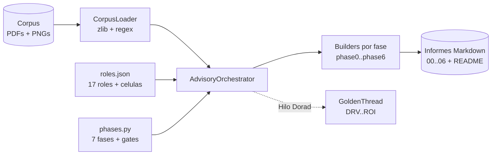

# advisory-system - Motor Zero-Drift para el Advisory Credi10 2.0

`advisory-system/` es un **motor de orquestacion escrito en Python puro (solo
biblioteca estandar)** que ejecuta el advisory de Credi10 2.0 con el framework
**Zero-Drift** y genera un informe en Markdown por cada una de las 7 fases (mas
un indice), con diagramas Mermaid, tablas y veredictos Go/No-Go.

Los informes generados viven en [`../advisory-credi10-2.0/`](../advisory-credi10-2.0/)
y son 100% reproducibles re-ejecutando el quickstart.

## Estrategia

El framework **Zero-Drift** se modela como **datos declarativos + plantillas por
fase + un orquestador**, de modo que el *que* (contenido del advisory) queda
separado del *como* (motor de ejecucion):

- **Roles declarativos.** Los 17 roles (ED, EM, AM, EA, BA, PIA, SME, TDA, DRE,
  SA, DA, PM, UX, AIA, FIN, SEC, ORG), el Comite de Gobierno y las 3 Celulas se
  definen como datos en `roles/roles.json` y se cargan en dataclasses `Role`.
- **Fases declarativas.** Las 7 fases (0..6), su liderazgo **RACI-V**, sus
  entregables, su **quality gate** (QG-0..QG-6) y el archivo de informe que
  producen se declaran en `engine/phases.py`.
- **Plantillas por fase.** Cada fase tiene un *builder* (`phases/phaseN.py`) que
  recibe un `BuildContext` y devuelve el cuerpo Markdown del informe. El
  contenido esta fundamentado en el corpus real (RFP, assessment WSO2/Studio F,
  diagramas).
- **Orquestador.** `engine/orchestrator.py` ejecuta cada fase en secuencia
  RACI-V: engancha a los productores (R), corre la verificacion del gate (V,
  gobierno AICV-E del AM), invoca al builder y escribe el informe.
- **Hilo Dorado.** `engine/model.py` mantiene un `GoldenThread` que encadena IDs
  unicos a traves de las fases
  (DRV -> CAP -> BMK -> GAP -> REL -> ABB -> SBB -> WAV -> ROI), de modo que cada
  decision tecnica es trazable hasta un indicador de retorno del RFP.

Principios transversales del framework: **RACI-V** (separacion productor R /
verificador V), **AICV-E** (gobierno de calidad a cargo del AM), **Hilo Dorado**
de trazabilidad, validacion **Dry-Run / Tabletop** antes del build y
**stage-gates** con No-Go explicito.

## Restriccion stdlib-only y extraccion de PDF

El entorno **no tiene acceso a PyPI** (no se puede `pip install`), por lo que el
motor usa **exclusivamente la biblioteca estandar de Python 3.11**.

Para leer el corpus **no** se usan librerias de PDF (pymupdf/pdfplumber no estan
disponibles). La extraccion de texto se hace con un enfoque **`zlib` + regex**:
se localizan los streams `FlateDecode` del PDF, se **descomprimen con `zlib`** y
se extrae el texto entre parentesis de los operadores `Tj`/`TJ`, limpiando
fragmentacion de caracteres y etiquetas de idioma. Los **diagramas PNG** son
imagenes binarias (no se hace OCR): se registran como evidencia (sha256, tamanio)
y su contenido se transcribe en el conocimiento de los roles/corpus. La mayoria
de los PDFs de proceso son ricos en imagenes con poco texto limpio extraible y se
tratan como evidencia secundaria de soporte.

## Estructura del directorio

```
advisory-system/
├── quickstart.py          # CLI de entrada (--phase, --corpus, --out)
├── README.md              # este documento
├── engine/                # nucleo del motor
│   ├── corpus.py          # CorpusLoader: descubre PDFs/PNGs y extrae texto (zlib+regex)
│   ├── model.py           # Role, Phase, Gate, RACI-V, GoldenThread (Hilo Dorado)
│   ├── phases.py          # catalogo declarativo de las 7 fases + gates + builders
│   └── orchestrator.py    # AdvisoryOrchestrator: ejecuta fases y escribe informes
├── roles/                 # catalogo declarativo de los 17 roles
│   ├── __init__.py        # carga roles.json en dataclasses Role
│   └── roles.json         # datos de roles, comite y celulas
├── phases/                # builders de contenido por fase
│   ├── builders.py        # BUILDERS (0..6) + build_readme (indice)
│   └── phase0.py .. phase6.py  # contenido fundamentado en el corpus por fase
└── tests/                 # pruebas unittest (stdlib)
    └── test_engine.py
```

## Como ejecutar

Desde la **raiz del repositorio** (`advisory/`):

```bash
# Pipeline completo: 7 informes (00..06) + README indice
python3 advisory-system/quickstart.py --phase all

# Regenerar una sola fase (ej. Fase 3)
python3 advisory-system/quickstart.py --phase 3

# Apuntar a otro corpus u otra carpeta de salida
python3 advisory-system/quickstart.py --corpus /ruta/al/corpus --out /ruta/salida
```

El corpus se **auto-descubre** en la raiz del repo (el padre de
`advisory-system/`) cuando no se pasa `--corpus`. Los informes se escriben en
`advisory-credi10-2.0/` por defecto.

## Como correr las pruebas

```bash
python3 -m unittest discover -s advisory-system/tests -v
```

Las pruebas validan el `CorpusLoader` (descubrimiento y extraccion del RFP), los
17 roles, las 7 fases y el contrato estructural de cada informe (Mermaid, tablas,
etiquetas epistemicas y veredicto de gate), ademas de contenido real por fase.

## Como se regeneran los informes

Los archivos de `advisory-credi10-2.0/*.md` son **artefactos generados**: se
versionan para que el resultado del advisory sea visible, pero siempre pueden
reproducirse con `python3 advisory-system/quickstart.py --phase all`. Para
cambiar el contenido de un informe se edita su builder (`phases/phaseN.py` o
`build_readme` en `phases/builders.py`) y se vuelve a ejecutar el quickstart; el
motor (`engine/`) no necesita modificarse.

## Arquitectura del motor


